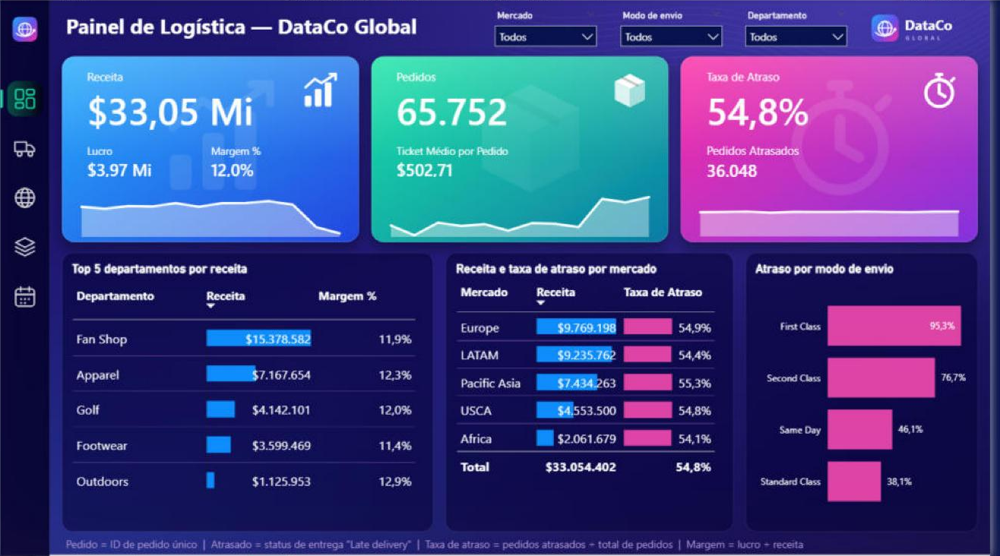

# 📊 Painel de Logística — DataCo Global (Power BI)

Case de BI completo sobre logística e vendas: do dado bruto ao painel, passando pela revisão do modelo de dados, medidas em DAX e um painel escuro com identidade visual própria em SVG.

> ⚠️ **Aviso:** os dados vêm de um dataset público do Kaggle. As conclusões valem para esse dataset e não representam empresas reais.



## 🎯 Objetivo

Responder às principais perguntas de negócio da área de logística:

1. Quantos pedidos a empresa recebeu e qual a receita, o lucro e a margem?
2. Qual a taxa de atraso nas entregas?
3. Como o atraso varia por modo de envio?
4. Como receita e atraso se comportam por mercado?
5. Quais são os 5 departamentos com maior receita (e sua margem)?
6. Como receita e taxa de atraso evoluíram mês a mês em 2017?

## 🔎 Principais achados

| Indicador | Valor |
|---|---|
| Receita | US$ 33,05 mi |
| Lucro | US$ 3,97 mi |
| Margem | 12,0% |
| Pedidos | 65.752 |
| Ticket médio por pedido | US$ 502,71 |
| Pedidos atrasados | 36.048 |
| Taxa de atraso geral | 54,8% |

- **A First Class (modo premium) atrasa em 95,3% dos pedidos**; Second Class 76,7%, Same Day 46,1% e Standard Class 38,1%.
- A taxa de atraso é parecida em todos os mercados (54,1% a 55,3%), o que sugere um problema de **processo** (ou da forma de medir o atraso) e não de um mercado específico.
- No 4º trimestre de 2017, o número de pedidos sobe enquanto a receita cai.
- **Próximo passo sugerido:** comparar o prazo prometido com o prazo real por modo de envio.

## 🧱 Modelo de dados

- Tabela fato de vendas (`Fvendas`) relacionada às dimensões: cliente, envio, região e produto.
- Tabela calendário (`dCalendário`) criada e relacionada à fato. Há um relacionamento inativo entre envio e calendário, usado com `USERELATIONSHIP` quando necessário.
- Tipos e formato numérico corrigidos (os números vinham lidos no padrão en-US).
- Chave criada na dimensão de clientes e dimensões de envio e região ligadas à fato pelo ID do item do pedido (via Power Query).

## 🧮 Medidas (DAX)

As medidas ficam em uma tabela própria, `_Medidas`.

```DAX
Receita = SUM ( Fvendas[Total do item do pedido] )

Lucro = SUM ( Fvendas[Lucro por pedido] )

Margem % = DIVIDE ( [Lucro], [Receita] )

Pedidos = DISTINCTCOUNT ( Fvendas[ID do pedido] )

Pedidos Atrasados =
CALCULATE (
    [Pedidos],
    dEnvio[Status da entrega] = "Late delivery"
)

Taxa de Atraso = DIVIDE ( [Pedidos Atrasados], [Pedidos] )

Ticket Médio por Pedido = DIVIDE ( [Receita], [Pedidos] )
```

> As fórmulas acima são a forma simplificada das definições usadas no relatório. Se o seu modelo tiver nomes diferentes, ajuste conforme necessário.

**Definições**

- **Pedido** = ID de pedido único.
- **Atrasado** = status de entrega `Late delivery`.
- **Taxa de atraso** = pedidos atrasados ÷ total de pedidos.
- **Margem** = lucro ÷ receita.

## 🎨 Painel


O painel usa cartões em degradê, menu lateral, filtros suspensos (Mercado, Modo de envio e Departamento), tabelas com barras de dados e mini-gráficos nos cartões. Responde às seis perguntas de negócio acima.

### Ativos SVG

A pasta [`svg/`](svg) traz os elementos desenhados para o painel escuro:

- `fundo_painel.svg` (fundo da página, 1280×720)
- `menu_lateral.svg`
- `logo_dataco.svg`
- `icone_receita.svg`, `icone_pedidos.svg`, `icone_atraso.svg`
- `menu_visao_geral.svg`, `menu_envios.svg`, `menu_mercados.svg`, `menu_departamentos.svg`, `menu_tempo.svg`

## 📁 Estrutura do repositório

```
.
├── README.md
├── imagens/          # prévia do painel
├── svg/              # ícones, menu, logo e fundo
├── LICENSE
└── DataGo_Relatorio_modelo_ajustado.pbix
```

> **Sobre o `.pbix`:** contém os dados importados do dataset do Kaggle (cerca de 18 MB; colunas de e-mail e senha do cliente removidas). Abra no Power BI Desktop; o aviso de login que ele pode exibir pode ser cancelado.

## 🗂️ Fonte dos dados

Dataset público no Kaggle: [DataCo Smart Supply Chain for Big Data Analysis](https://www.kaggle.com/datasets/shashwatwork/dataco-smart-supply-chain-for-big-data-analysis).
Os dados pertencem ao autor do dataset; confira a licença na página antes de redistribuir.

## 🛠️ Ferramentas

Power BI Desktop · DAX · Power Query · SVG

## 👤 Autor

**Jair** — Coordenação de Business Intelligence · Power BI e Excel
[GitHub](https://github.com/dasilvajair447-collab)

## 📄 Licença

Código, medidas e documentação sob licença [MIT](LICENSE). Os dados originais seguem a licença do dataset no Kaggle.
