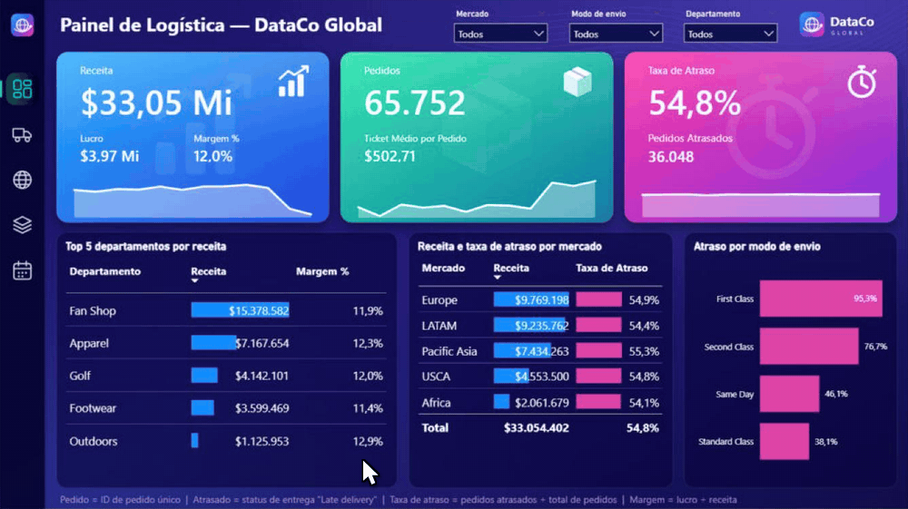
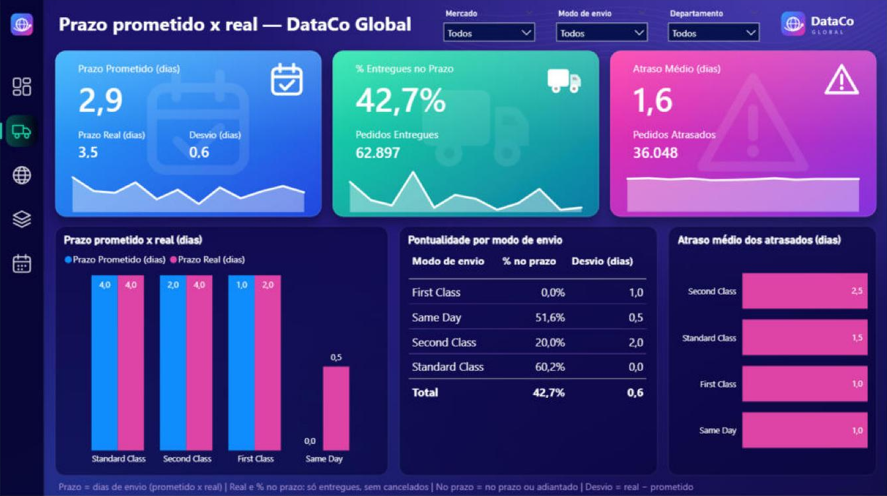

# 📊 Painel de Logística — DataCo Global (Power BI)



*Navegação pelo menu lateral entre as duas páginas do relatório. Ilustração montada com capturas reais das páginas; o cursor e o clique foram desenhados.*

Case de BI completo sobre logística e vendas: do dado bruto ao painel, passando pela revisão do modelo de dados, medidas em DAX e um painel escuro com identidade visual própria em SVG. O relatório tem duas páginas: a **visão geral** e a análise **Prazo x Real** (prazo prometido x prazo real de entrega por modo de envio), com navegação pelo menu lateral para alternar entre elas.

> ⚠️ **Aviso:** os dados vêm de um dataset público do Kaggle. As conclusões valem para esse dataset e não representam empresas reais.




## 🎯 Objetivo

Responder às principais perguntas de negócio da área de logística:

1. Quantos pedidos a empresa recebeu e qual a receita, o lucro e a margem?
2. Qual a taxa de atraso nas entregas?
3. Como o atraso varia por modo de envio?
4. Como receita e atraso se comportam por mercado?
5. Quais são os 5 departamentos com maior receita (e sua margem)?
6. Como receita e taxa de atraso evoluíram mês a mês em 2017?
7. Quanto cada modo de envio promete de prazo e quanto entrega de fato?

## 🔎 Principais achados

| Indicador | Valor |
|---|---|
| Receita | US$ 33,05 mi |
| Lucro | US$ 3,97 mi |
| Margem | 12,0% |
| Pedidos | 65.752 |
| Ticket médio por pedido | US$ 502,71 |
| Pedidos atrasados | 36.048 |
| Taxa de atraso geral | 54,8% |

- **A First Class (modo premium) atrasa em 95,3% dos pedidos**; Second Class 76,7%, Same Day 46,1% e Standard Class 38,1%.
- A taxa de atraso é parecida em todos os mercados (54,1% a 55,3%), o que sugere um problema de **processo** (ou da forma de medir o atraso) e não de um mercado específico.
- No 4º trimestre de 2017, o número de pedidos sobe enquanto a receita cai.

### Prazo prometido x prazo real, por modo de envio

| Modo de envio | Prazo prometido (dias) | Prazo real (dias) | Entregues no prazo | Desvio (dias) | Atraso médio dos atrasados (dias) |
|---|---:|---:|---:|---:|---:|
| First Class | 1,0 | 2,0 | 0,0% | +1,0 | 1,0 |
| Same Day | 0,0 | 0,5 | 51,6% | +0,5 | 1,0 |
| Second Class | 2,0 | 4,0 | 20,0% | +2,0 | 2,5 |
| Standard Class | 4,0 | 4,0 | 60,2% | 0,0 | 1,5 |
| **Total** | **2,9** | **3,5** | **42,7%** | **+0,6** | **1,6** |

*Prazo real e % no prazo consideram só pedidos entregues (sem cancelados). "No prazo" = entregue no prazo ou adiantado. Desvio = prazo real − prazo prometido.*

- **First Class:** promete 1 dia e entrega em 2; entre os pedidos entregues, nenhum chegou no prazo.
- **Same Day:** promete o mesmo dia e quase metade leva 1 dia a mais (51,6% no prazo).
- **Second Class:** promete 2 dias e entrega em 4, o mesmo tempo da Standard Class; só 20,0% chegam no prazo, com atraso médio de 2,5 dias.
- **Standard Class:** promete 4 e entrega em 4; é a que melhor cumpre a promessa (60,2% no prazo ou adiantados).
- First Class e Same Day são mais rápidas que a Standard, mas prometem prazos tão curtos que um dia a mais já vira atraso. A Second Class promete uma velocidade que, nesses dados, não aparece.
- **Detalhe de definição:** a taxa oficial de atraso (95,3% na First Class) conta os pedidos cancelados no denominador. Olhando só os pedidos entregues, a First Class atrasa em 100% dos casos. Escolher o denominador também é uma decisão de negócio.
- **Próximo passo sugerido:** cruzar o prazo prometido x real com mercado e departamento, para ver se o desvio muda conforme o destino ou o tipo de produto.

## 🧱 Modelo de dados

- Tabela fato de vendas (`Fvendas`) relacionada às dimensões: cliente, envio, região e produto.
- Tabela calendário (`dCalendário`) criada e relacionada à fato. Há um relacionamento inativo entre envio e calendário, usado com `USERELATIONSHIP` quando necessário.
- Tipos e formato numérico corrigidos (os números vinham lidos no padrão en-US).
- Chave criada na dimensão de clientes e dimensões de envio e região ligadas à fato pelo ID do item do pedido (via Power Query).

## 🧮 Medidas (DAX)

As medidas ficam em uma tabela própria, `_Medidas`.

```DAX
Receita = SUM ( Fvendas[Total do item do pedido] )

Lucro = SUM ( Fvendas[Lucro por pedido] )

Margem % = DIVIDE ( [Lucro], [Receita] )

Pedidos = DISTINCTCOUNT ( Fvendas[ID do pedido] )

Pedidos Atrasados =
CALCULATE (
    [Pedidos],
    dEnvio[Status da entrega] = "Late delivery"
)

Taxa de Atraso = DIVIDE ( [Pedidos Atrasados], [Pedidos] )

Ticket Médio por Pedido = DIVIDE ( [Receita], [Pedidos] )
```

Medidas da página **Prazo x Real**:

```DAX
Prazo Prometido (dias) =
CALCULATE (
    AVERAGE ( dEnvio[Dias para envio (programado)] ),
    KEEPFILTERS ( dEnvio[Status da entrega] <> "Shipping canceled" )
)

Prazo Real (dias) =
CALCULATE (
    AVERAGE ( dEnvio[Dias para envio (real)] ),
    KEEPFILTERS ( dEnvio[Status da entrega] <> "Shipping canceled" )
)

Desvio de Prazo (dias) = [Prazo Real (dias)] - [Prazo Prometido (dias)]

Pedidos Cancelados =
CALCULATE (
    [Pedidos],
    dEnvio[Status da entrega] = "Shipping canceled"
)

Pedidos Entregues = [Pedidos] - [Pedidos Cancelados]

Pedidos No Prazo =
CALCULATE (
    [Pedidos],
    dEnvio[Status da entrega] = "Shipping on time"
)

Pedidos Adiantados =
CALCULATE (
    [Pedidos],
    dEnvio[Status da entrega] = "Advance shipping"
)

% Entregues no Prazo =
DIVIDE (
    COALESCE ( [Pedidos No Prazo], 0 ) + COALESCE ( [Pedidos Adiantados], 0 ),
    [Pedidos Entregues]
)

Atraso Médio (dias) =
CALCULATE (
    [Desvio de Prazo (dias)],
    dEnvio[Status da entrega] = "Late delivery"
)
```

> As fórmulas da primeira lista são a forma simplificada das definições usadas no relatório; as da página Prazo x Real seguem o modelo, só com quebras de linha para facilitar a leitura. Se o seu modelo tiver nomes diferentes, ajuste conforme necessário.

**Definições**

- **Pedido** = ID de pedido único.
- **Atrasado** = status de entrega `Late delivery`.
- **Taxa de atraso** = pedidos atrasados ÷ total de pedidos.
- **Margem** = lucro ÷ receita.
- **Prazo prometido / prazo real** = média dos dias de envio programados / realizados por item de pedido, sem os cancelados (`Shipping canceled`).
- **Entregue no prazo** = pedido com status `Shipping on time` ou `Advance shipping`, dividido pelos pedidos entregues (todos menos os cancelados).
- **Atraso médio** = desvio médio de prazo apenas dos pedidos com status `Late delivery`.
- **Desvio de prazo** = prazo real − prazo prometido.

## 🎨 Painel

### Visão geral


O painel usa cartões em degradê, menu lateral, filtros suspensos (Mercado, Modo de envio e Departamento), tabelas com barras de dados e mini-gráficos nos cartões. Responde às seis primeiras perguntas de negócio acima.

### Prazo x Real


Segunda página, no mesmo estilo: cartões com prazo prometido, prazo real e desvio, % de pedidos entregues no prazo e atraso médio; colunas de prometido x real por modo de envio; tabela de pontualidade; e barras com o atraso médio dos pedidos atrasados. Os ícones **Visão geral** e **Envios** do menu lateral funcionam como botões e alternam entre as duas páginas (no Power BI Desktop, use Ctrl + clique; no Power BI Service, basta clicar).

### Ativos SVG

A pasta [`svg/`](svg) traz os elementos desenhados para o painel escuro:

- `fundo_painel_completo.svg`: fundo da página de visão geral (1280×720) com menu lateral, logo e ícones dos cartões já embutidos. Pode ser aplicado direto como imagem de fundo da página, sem visuais de imagem por cima.
- `fundo_painel_prazo.svg`: fundo da página **Prazo x Real** (1280×720), com o item "Envios" ativo no menu.

Peças separadas, para reutilizar em outros projetos:

- `fundo_painel.svg` (só cartões e painéis, 1280×720)
- `menu_lateral.svg`
- `logo_dataco.svg`
- `icone_receita.svg`, `icone_pedidos.svg`, `icone_atraso.svg`
- `menu_visao_geral.svg`, `menu_envios.svg`, `menu_mercados.svg`, `menu_departamentos.svg`, `menu_tempo.svg`

## 📁 Estrutura do repositório

```
.
├── README.md
├── imagens/          # prévias das duas páginas e GIF de navegação
├── svg/              # ícones, menu, logo e fundos
├── LICENSE
└── DataGo_Relatorio_modelo_atualizado.pbix
```

> **Sobre o `.pbix`:** contém os dados importados do dataset do Kaggle (cerca de 18 MB; colunas de e-mail e senha do cliente removidas). Abra no Power BI Desktop; o aviso de login que ele pode exibir pode ser cancelado.

## 🗂️ Fonte dos dados

Dataset público no Kaggle: [DataCo Smart Supply Chain for Big Data Analysis](https://www.kaggle.com/datasets/shashwatwork/dataco-smart-supply-chain-for-big-data-analysis).
Os dados pertencem ao autor do dataset; confira a licença na página antes de redistribuir.

## 🛠️ Ferramentas

Power BI Desktop · DAX · Power Query · SVG

## 👤 Autor

**Jair** — Analista de Dados · Power BI e Excel
[GitHub](https://github.com/dasilvajair447-collab)

## 📄 Licença

Código, medidas e documentação sob licença [MIT](LICENSE). Os dados originais seguem a licença do dataset no Kaggle.
